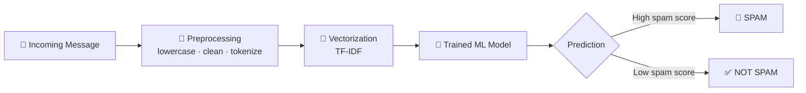

# 📧 Message Intelligence System

**An end-to-end machine learning system that decides: is this email / message _SPAM_ or _NOT SPAM (HAM)_?**


🔗 **Live App:** [https://message-intelligence-system-4519.streamlit.app/](https://message-intelligence-system-4519.streamlit.app/)

[](https://message-intelligence-system-4519.streamlit.app/)


</div>

---

## ✨ Overview

Message Intelligence System reads a raw email or text message, cleans it, converts it into numerical features, and passes it to a trained classifier that returns a clear verdict: **SPAM** 🚫 or **HAM** ✅ (legitimate).

## 🔄 High-Level Flow



| Step | What happens |
|------|--------------|
| **1. Input** | User pastes an email or message into the app |
| **2. Preprocess** | Lowercasing, removing punctuation/stop-words, tokenizing/stemming |
| **3. Vectorize** | Text is converted into numeric features (TF-IDF) |
| **4. Predict** | The saved model in `Model/` scores the message |
| **5. Verdict** | The app displays **SPAM** or **NOT SPAM** |

## 📁 Project Structure

```
Message-Intelligence-System-/
├── Data/            # Dataset used for training & testing
├── Model/           # Saved/trained model (and vectorizer)
├── Notebook/        # Exploration, training & evaluation notebooks
├── app.py           # Application entry point (prediction UI)
├── requirements.txt # Python dependencies
└── README.md
```

## 🚀 Getting Started

```bash
# 1. Clone the repository
git clone https://github.com/TrivediMan/Message-Intelligence-System-.git
cd Message-Intelligence-System-

# 2. (Optional) create a virtual environment
python -m venv venv
source venv/bin/activate        # Windows: venv\Scripts\activate

# 3. Install dependencies
pip install -r requirements.txt

# 4. Run the app
python app.py
# If app.py uses Streamlit:  streamlit run app.py
```

## 🧪 Example

| Message | Prediction |
|---------|------------|
| "Congratulations! You WON a free prize, click now!!!" | 🚫 **SPAM** |
| "Hi team, the meeting is moved to 3 PM tomorrow." | ✅ **NOT SPAM** |

## 🧠 How the Model Works

1. **Training** (see `Notebook/`): the labelled dataset in `Data/` is cleaned, vectorized and used to train a classifier.
2. **Evaluation**: accuracy, precision, recall and F1-score are checked — precision matters most so real emails are not wrongly flagged.
3. **Deployment**: the trained model is saved to `Model/` and loaded by `app.py` for instant predictions.

## 🛠️ Tech Stack

- **Language:** Python
- **NLP / ML:** scikit-learn, NLTK / pandas / NumPy
- **Interface:** `app.py`

## 🔮 Future Improvements

- [ ] Deep-learning models (LSTM / BERT)
- [ ] Multi-language support
- [ ] Gmail / Outlook inbox integration
- [ ] Explainable predictions (highlight spam-trigger words)
- [ ] REST API + Docker deployment

## 🤝 Contributing

Pull requests are welcome. For major changes, please open an issue first.

## 👤 Author

**TrivediMan** — [GitHub](https://github.com/TrivediMan)

---

<div align="center">⭐ If you find this useful, give the repo a star!</div>
<text x="450" y="225" text-anchor="middle" fill="#fca5a5" font-size="13">Pass 1: "WIN a FREE prize, click now!!!"  →  SPAM</text>
<text x="450" y="250" text-anchor="middle" fill="#93c5fd" font-size="13">Pass 2: "Meeting moved to 3 PM tomorrow"  →  HAM</text>
</svg>
